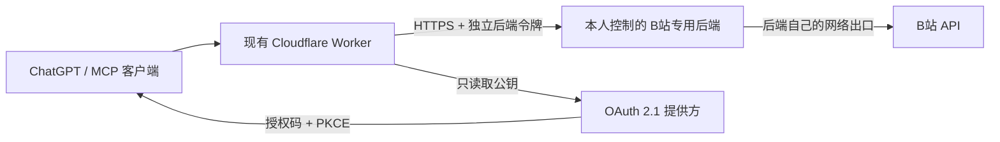

# 网络与 ChatGPT 认证接入方案

第二轮调查日期：2026-11-13。请求后端与 OAuth 资源服务器已实现；独立网络、OAuth 授权提供方和 ChatGPT 账户端尚未接通。不要把下述配置说明当作线上验收成功。

## 为什么本次不继续试请求头

同一公开视频接口在 Codex 云端匿名请求取得 HTTP 200 / 业务码 0 / 有效标题，在本次 Worker 的匿名和携带现有登录 Cookie 请求中均返回 HTTP 412。评论热度接口也存在云端成功响应，Worker 六个对照请求全部为 412。登录检查接口本身不需要 WBI，因此这些 412 不能归因于 WBI 签名或 CSRF。

证据支持本次 Cloudflare Worker 出口或其连接特征受限，不能证明所有 Cloudflare IP 均被永久限制。现有 Cookie 在本次 Worker 测试中没有改善，登录态是否有效仍未知。开发环境是 Codex 云端，不是用户本机；没有为了补齐矩阵从 Cloudflare 导出 Cookie。本轮不再反复改变域名、头或签名。

- `SESSDATA`：登录会话，影响登录检查和部分字幕/个人内容；它不是访问权限保证。
- `bili_jct`：写入表单的 CSRF 值，不是解除读取风控的参数。
- `buvid3`：浏览器设备标识，部分接口可能需要；不能据此承诺解除 HTTP 412。保留已有可选 Secret，不伪造设备指纹。
- WBI：按实时 nav 信息生成混合密钥、排序/过滤参数、加入秒级 `wts` 并计算 MD5。现有实现与参考项目采用相同基本原理；HTTP 412、业务码 -352、登录码 -101 和 CSRF 码 -111 分别处理，不互相冒充。

## 参考项目的实际做法

- [XZXZZX-Ai/bilibili-mcp](https://github.com/XZXZZX-Ai/bilibili-mcp)：默认本地 stdio，通过本机 Node.js 网络发请求；[HTTP 层](https://github.com/XZXZZX-Ai/bilibili-mcp/blob/master/src/bilibili/http.ts) 集中处理限流、Cookie、WBI 与错误；[指纹模块](https://github.com/XZXZZX-Ai/bilibili-mcp/blob/master/src/bilibili/fingerprint.ts) 从公开接口获取设备标识。这不是 Workers 出口可用的证据。
- [BiliParser-API](https://github.com/kiyonya/BiliParser-API)：[proxy-fetch](https://github.com/kiyonya/BiliParser-API/blob/main/src/utils/proxy-fetch.ts) 支持独立请求后端和后端令牌，[配置](https://github.com/kiyonya/BiliParser-API/blob/main/src/config.ts) 中代理开关默认开启；[bili-crypto](https://github.com/kiyonya/BiliParser-API/blob/main/src/utils/bili-crypto.ts) 合并匿名 Cookie 与可选登录 Cookie，并处理 WBI。其 [README](https://github.com/kiyonya/BiliParser-API#readme) 明确把 Vercel Serverless Functions 作为独立出口方案，并链接本人部署的代理项目。这是该项目维护者对 Cloudflare IP 限制的描述，不是本项目已经验证 Vercel 可用的证据；也不能证明 Worker 直连可靠。

仅研究原理，没有复制第三方实现；未采用其随机指纹、票据构造、原始响应日志或自动重试策略。

## 可审查的独立出口方案

`src/bilibili/transport.ts` 保留直连为默认；只在显式 `BILI_TRANSPORT=backend` 时使用指定后端。现有 9 个工具及输入输出结构保持不变。后端失效时不会自动换出口或重试写入。

`backend/handler.mjs` / `backend/server.mjs` 是无数据库、无依赖的 Node.js 24 专用后端。它验证独立令牌，只允许现有 B站 API 路径和有限字幕 CDN，拒绝任意 URL、重定向、任意请求头和并发操作，不记录请求内容，不转发 Set-Cookie；默认仅监听 `127.0.0.1:8788`。

| 方式 | 操作与前提 | 费用和可用性 | 当前状态 |
| --- | --- | --- | --- |
| 按需个人电脑 + Cloudflare Tunnel | 使用时启动 Node 后端与 cloudflared；先验证该电脑能访问 B站；会话期间保持在线 | 不需要购买服务器；电脑关机或 Tunnel 退出即不可用；不能承诺 Tunnel 与账号套餐始终免费 | 代码已准备，未在用户设备部署 |
| 已有自有服务器 + HTTPS 或 Tunnel | 同一后端放在本人已有机器；HTTPS 反代或 Tunnel 接入 | 需要维护机器；先验证其实际出口，不假定任意 VPS 可用 | 未提供已授权目标，未部署 |
| 新的受信托管服务 | 先明确提供方、账户、出口试验、费用上限和凭据处理，再执行 | 无常开设备时可考虑；免费额度和出口可用性均须单独确认 | 没有创建账号、购买或部署 |

Cloudflare Tunnel 只把 Worker 请求送至后端；后端对 B站的连接使用后端网络出口。仅安装 Tunnel 而仍由 Worker 直连 B站，不会改变问题。[官方 Tunnel 原理](https://developers.cloudflare.com/tunnel/)。固定命名 Tunnel 通常还需管理路由/域名；Quick Tunnel 的临时地址会变化，只适合临时验证。

### 本人确认后才执行的操作清单

1. 确认使用方式、可信机器及其 B站可达性；如涉及新托管服务，先明确账单和授权。
2. 在该机器安全设置至少 32 位随机 `BILI_BACKEND_TOKEN`，启动 `node backend/server.mjs`。没有输入 Cookie 的命令行参数。
3. 如选择 Tunnel，在该机器安装/启动 `cloudflared`，把 HTTPS 入口映射到 `http://127.0.0.1:8788`。需要批准网络接入；本轮未执行安装、路由或 DNS 变更。
4. Worker 设置普通变量 `BILI_BACKEND_URL=https://backend.example.com/bilibili`、`BILI_TRANSPORT=backend`；通过 `npm exec -- wrangler secret put BILI_BACKEND_TOKEN` 隐藏输入同一后端令牌，再部署。
5. 这会让本人的受信后端收到 B站请求及其中所需 Cookie/CSRF，因此必须先同意此凭据处理边界。Cookie 仍保存在 Worker Secrets，不发送给公共代理或 OAuth 提供方；后端只在内存里将它们转交给精确的 B站 API 主机，绝不记录。
6. 经正式 MCP 逐一验收七个只读工具；登录检查成功且发送目标/正文明确后才测试写入。

回退时设 `BILI_TRANSPORT=direct` 并部署；这会停止向后端传递请求，但不会自动解除 B站对 Worker 出口的限制。不要把 Codex 临时工作环境当作用户长期后端。

## ChatGPT 的真实认证边界

截至本次查阅，OpenAI 的 [自定义 MCP 连接说明](https://developers.openai.com/api/docs/guides/custom-mcp-server) 列出 OAuth、无鉴权、OAuth 或无鉴权，支持 Streamable HTTP；[认证文档](https://developers.openai.com/plugins/build/auth) 明确 ChatGPT 不能呈现自定义 API Key。固定 `Authorization: Bearer ...` 属于 API Key 方式，不等同于 OAuth。原来的“如果界面支持自定义 Header”说明不能作为 ChatGPT 可连接结论，已修正。

当前 Plugins 界面可直接添加自定义 MCP，无需先启用旧 Developer Mode；旧界面入口可能不同。[帮助中心](https://help.openai.com/en/articles/12584461-connecting-custom-mcp-servers-in-chatgpt) 明确 Business / Enterprise / Edu 的完整能力、Pro 的受限能力，没有为 Plus 提供本项目可依赖的完整自定义 MCP 保证。应以实际账号入口与权限为准；不能把界面里的“plus button”理解成 Plus 套餐支持，也不能因为通用协议支持写入就断言 Plus 可写。

本轮实现 **OAuth 资源服务器**，不在无状态 Worker 内自造授权码服务器。一次性授权码、PKCE、刷新与授权状态由可信标准 OAuth 2.1 提供方负责；避免为了认证引入 KV、D1 或自建用户管理。

### 提供方要求与配置

可评估本人控制的标准 OAuth 2.1 / OIDC 提供方。例如 Auth0 官方支持 [MCP 与 Resource Parameter Compatibility](https://auth0.com/blog/secure-csharp-mcp-server-with-auth0/)；并非要求使用它，也未注册或授权该服务。配置前须确认账户、套餐、费用及具体 MCP 能力。

提供方需要：

- Authorization Code + PKCE S256，HTTPS 授权与令牌端点，正式 discovery 元数据；
- RFC 8707 `resource` 映射到本 MCP 的 JWT `aud`；
- 预注册 ChatGPT 客户端，或明确支持 CIMD / DCR；不需要为本项目开放任意动态注册；
- 精确允许 ChatGPT 管理界面显示的 redirect URI，不使用通配符；支持刷新时配置 refresh token rotation；
- RS256 或 ES256 签名 JWT，包含 `iss`、`aud`、`sub`、`exp`、`iat` 和空格分隔的 `scope`。

在 Worker 中配置以下普通变量（仓库只保留空值）：

| 变量 | 值 |
| --- | --- |
| `OAUTH_ISSUER` | 与提供方 discovery 的 issuer 完全一致，包括末尾斜杠 |
| `OAUTH_RESOURCE` | 本 Worker 的完整 HTTPS `/mcp` 连接地址，也必须是 JWT 的 audience |
| `OAUTH_JWKS_URL` | 提供方公开 JWKS HTTPS 地址，不含令牌或查询参数 |

通过 `npm exec -- wrangler secret put OAUTH_ALLOWED_SUBJECT` 隐藏输入本人在该提供方的精确 `sub`。这是个人服务白名单，不能留空或允许该提供方所有用户；不把个人标识提交到仓库。

资源端仅使用配置的公钥，验证签名、issuer、audience、过期时间、本人 subject 和 scopes，不信任 JWT 自带公钥 URL。不向 JWKS 请求发送 JWT、B站 Cookie 或服务令牌。`bili:read` 可发现工具及调用七个读取工具；两个发布工具另需 `bili:write`，否则在发起 B站请求前拒绝。静态令牌仍支持现有可信通用 MCP 客户端。

配置完整后，`/.well-known/oauth-protected-resource` 和 `/.well-known/oauth-protected-resource/mcp` 返回公开资源元数据；401 带 `resource_metadata` challenge，写入缺权限时工具返回 OAuth scope challenge。未配置提供方时不伪造 metadata 或登录页面，不降低原鉴权。

### 配置完成后的 ChatGPT 操作

1. 在提供方完成上述本人账户与客户端配置；客户端 ID / Secret 如需要，输入 ChatGPT 的连接表单，绝不发送到聊天或仓库。
2. 先检查资源 metadata 的 resource/issuer 和提供方 discovery 是否一致。
3. ChatGPT 网页 → Plugins → Add custom MCP server → 填现有 `/mcp` 地址 → **OAuth**。旧界面可在 Apps/Create 或 Developer Mode 下创建。
4. 完成提供方登录与授权，扫描全部 9 个工具；先只申请 `bili:read`。
5. 指定 Bili Observer 搜索一个主题并读取一个视频。必须在网络后端可用后验证真实结果，而非仅看 HTTP 200 或工具列表。
6. 确有写入需要且账户套餐允许时再授权 `bili:write`；服务端始终保留写入工具。

当前没有已配置的外部提供方或可操作的已登录 ChatGPT 账户会话，以上是操作步骤，不是实测通过。现有 Worker 仍使用静态令牌供通用客户端连接。
