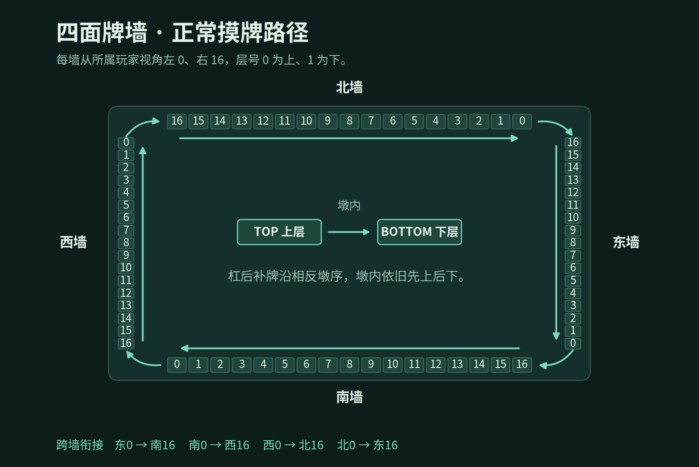
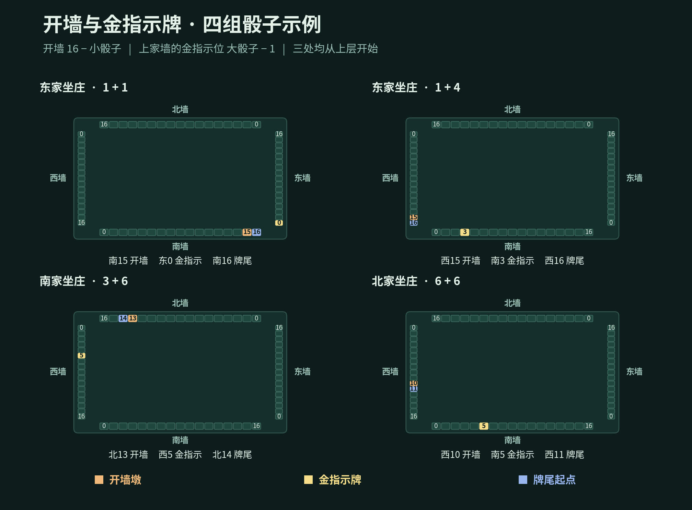

# v0.7.1 实体牌墙规则

## 座位和物理位置

东、南、西、北的座位编号分别为 0、1、2、3。玩家逆时针行动，东 → 南 → 西 → 北 → 东。发牌从庄家起，按玩家行动顺序发三轮，每轮每人取两墩共四张，再依次发一张，最后给庄家多发一张。庄家共 14 张，闲家各 13 张。发牌和回合中的正常摸牌使用同一游标。

实体牌墙共 68 墩、136 张。每墙 17 墩，列号从墙所属玩家的视角由左到右为 0 至 16。层号 0 为上层 TOP，1 为下层 BOTTOM。服务端用 `(side, column, layer)` 标识实牌位置。客户端只随观察者旋转这四面墙，列号和层号保持原样。单机固定视角中，北在上、东在右、南在下、西在左。

## 开墙与金指示牌

设小骰子为 `a`，大骰子为 `b`，点数和为 `s`。从庄家算第 1 位，沿东、南、西、北循环数到第 `s` 位。点数和为 5 或 9 时改用庄家对家。

- 开墙从开墙墙的右端向左跳过 `a` 墩，开墙位为 `(break_wall, 16 - a, TOP)`。
- 金指示牌在开墙墙的上家墙 `previous_seat(break_wall)`。从该墙左端起按 1 起算数到第 `b` 墩，墙位为 `(previous_seat(break_wall), b - 1, TOP)`。
- 金指示位独立计算。翻开后仍占着原来的实牌位置、计入墙上余牌，并继续沿用金牌映射和已见牌规则。轮到该位置时，正常摸牌和杠后补牌都可将指示牌取走。中央区域继续显示公开的指示牌和金牌。

| 庄家 | 骰子 | 开墙 | 金指示牌 | 牌尾起点 |
| --- | --- | --- | --- | --- |
| 东 | 1、1 | 南15上 | 东0上 | 南16上 |
| 东 | 1、4 | 西15上 | 南3上 | 西16上 |
| 南 | 3、6 | 北13上 | 西5上 | 北14上 |
| 北 | 6、6 | 西10上 | 南5上 | 西11上 |

## 取牌路径

正常摸牌沿物理牌墙顺时针行进，从开墙墩开始，墙内列号递减。四个墙角依次为东0 → 南16、南0 → 西16、西0 → 北16、北0 → 东16。

按单机屏幕位置，北墙从左往右、东墙从上往下、南墙从右往左、西墙从下往上。

牌尾起点是开墙墩沿正常方向的前一墩。杠后补牌逆着上述墩序行进，每墩依旧先取 TOP，再取 BOTTOM。两套游标读取同一组实体墙位，取走后标记为空，另一端跳过已取走的墙位。同一墩只剩一张时，任何一端只可取这张剩牌。

## 死墙与余牌

从原开墙点起按正常路径为实牌编号，前 `max(0, 136 - 2 * max(7, 杠数 + 6))` 个位置属于正常摸牌范围。杠数为 0、1、2、3、4 时分别保留 7、7、8、9、10 墩。补牌按既有杠动作规则每杠取一张，要求牌尾仍有可用实牌。正常摸牌到达保留区或在范围内无牌可取时流局。补牌和翻指示牌都不重新定义边界的起点。

顶部「余」是正常范围内仍在墙上的牌数。牌局详情中的「墙上实牌」统计包括死墙在内的所有未取走牌。翻开金指示牌保持这两个数量，实际取牌时再按墙位扣减。
