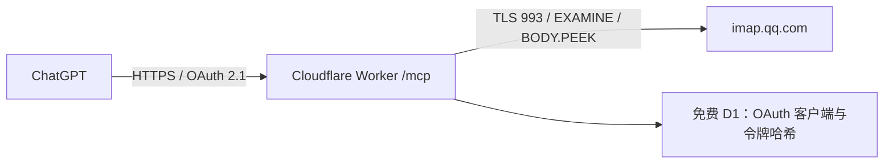

# QQ Mail MCP

单用户、只读、按需连接的 QQ 邮箱 MCP Server。TypeScript + 官方 MCP SDK + Cloudflare Workers TCP/TLS；无需本地电脑、VPS 或常驻进程。



## 工具

| 工具 | 功能 |
|---|---|
| `mail_status` | TLS/IMAP 登录状态，返回脱敏错误 |
| `mail_list_folders` | 可读取文件夹，支持 IMAP modified UTF-7 中文名称 |
| `mail_search` | 文件夹、发件人、主题、关键词、日期、未读和分页；默认/最多 20 封 |
| `mail_read` | 按 UID + UIDVALIDITY 读取，正文转纯文本，附件只返回元数据 |
| `mail_batch_read` | 同一文件夹最多 3 封，允许部分成功 |
| `mail_attachment_info` | 只请求 BODYSTRUCTURE，不下载附件 |

`since` 包含当天，`before` 不包含当天，使用 IMAP 内部日期；UID 从大到小排序。页码从 1 开始，新邮件到达会使页码移动。发生 `UIDVALIDITY_CHANGED` 时必须重新搜索，不能复用旧 UID。

## 开发与测试

需要 Node.js 24+，浏览器回归还需 Chromium（可通过 `CHROMIUM_PATH` 指定绝对路径）。

本目录是迁入多项目仓库的现有服务，范围为六个只读工具、OAuth、IMAP、安全限制与完整测试；与离线代码分析/约束实验项目无重复。迁移记录及线上一致性证据见 [MIGRATION.md](docs/MIGRATION.md)。

```sh
npm ci
npx playwright-core install --with-deps chromium
# 设置 CHROMIUM_PATH 为安装的 Chromium 路径，或使用系统 /usr/bin/chromium。
npm run typecheck
npm test
npm run build
npm run dev
```

本地运行时复制 `.env.example` 到 `.dev.vars`，只在本机私密文件中设置测试凭据。`PUBLIC_ORIGIN` 必须与请求来源一致；本地开发可通过 `wrangler dev --var PUBLIC_ORIGIN:http://localhost:8787` 调整。生产 OAuth Cookie 必须 Secure，因此完整授权流程应在 HTTPS 环境测试。本地测试使用模拟 IMAP 和 Miniflare 的真实本地 D1，不读取真实邮箱。

## 认证

ChatGPT 使用 OAuth 2.1 授权码 + S256 PKCE，DCR 公共客户端，无客户端密码。授权页面要求独立的 `OWNER_PASSWORD`，不是邮箱授权码。授权码 120 秒、一次性消费；访问令牌有效 365 天（与迁移核对时的线上版本一致）。到期需重新授权，当前版本不提供刷新令牌。`/revoke` 支持立即撤销令牌。

公开接口仅包括 `/health`、OAuth 发现及登录/授权入口。`/mcp` 的初始化、工具发现和调用全部需要有效 Bearer 访问令牌。缺少 Owner Secret 时拒绝所有 MCP 访问；缺少邮箱 Secrets 时即使已通过 OAuth 也不会连接邮箱。

生产部署、ChatGPT 接入和秘密配置见 [部署文档](docs/DEPLOYMENT.md)。实际验收结果见 [验收记录](docs/ACCEPTANCE.md)。威胁模型和限制见 [安全说明](SECURITY.md)。

## 资源上限与免费套餐

- 每次工具调用一条 TCP 连接；TLS 固定 `imap.qq.com:993`，不提供自定义 host。
- 单步网络等待 8 秒，IMAP 操作总计 20 秒；批量在约 14 秒后不再启动新邮件。
- 文本 MIME 内容累计最多 128 KiB/邮件；输出正文最多 40,000 字符，明确标注截断。
- 单条 IMAP 响应最多 512 KiB、整个连接最多接收 2 MiB；头部最多 32 KiB。
- 批量最多 3 封，总返回内容有预算；MIME 限制 100 个部分和 20 层嵌套。
- 入站 JSON/form 最多 16 KiB、读取 body 最多 5 秒；不接受 JSON-RPC 批量请求。
- 每个 Cloudflare 节点约 30 请求/分钟/IP，邮箱操作另有单用户限流；限流最终一致，不是全球精确计费器。
- D1 只存 OAuth 元数据和哈希，不存邮件或邮箱密码；没有 Durable Objects、KV、付费数据库、AI API。
- Workers Free 的 CPU 时间/每日请求额度仍适用。网络等待不计 CPU，但 MIME/HTML 解析计 CPU；复杂邮件可能触发免费 CPU 上限。先缩小批量和邮件范围，不自动升级套餐。

## 已知边界

不支持附件下载、嵌套 `.eml` 正文展开、发送/删除/移动/标签修改；附件 `size` 为 IMAP BODYSTRUCTURE 的编码后字节数，并非解码后文件大小。优先选纯文本部分，无纯文本时转换 HTML。中文搜索依赖 QQ 对 `CHARSET UTF-8` 的支持；服务器拒绝时返回 `IMAP_REJECTED`，不悄悄改变搜索语义。没有缓存邮件。真实 QQ 登录、中文文件夹和状态不变仍须使用用户安全配置的凭据验收。


公开 `wrangler.jsonc` 与插件 `mcp.json` 使用保留域名和示例资源 ID。已有服务部署必须使用被忽略的 `wrangler.local.jsonc`，不要直接把公开模板部署到生产。CI 只执行检查与 dry-run 构建，不部署。完整流程见部署文档；此迁移未修改线上服务。

浏览器测试当前已在 Linux / Chromium 验证。Windows 可通过 `CHROMIUM_PATH` 指向实际浏览器，但尚未对本项目进行 Windows 原生回归。授权页面按钮仍显示“一小时”，而当前线上令牌期限为 365 天；为保留当前运行模块，此次仅在文档说明该既有不一致，后续应单独修正并重新验收。
